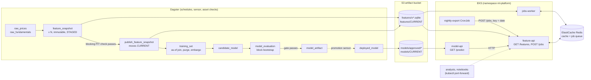

# ml-platform-infra

[](https://github.com/Avinash186200/ml-platform-infra/actions/workflows/ci.yml)
[](LICENSE)


A small, reproducible ML platform: Terraform for AWS, Kubernetes manifests, a Dagster asset graph with data-quality and leakage checks and a promotion gate, and a feature API that answers "what did we know about this entity at time T" without ever returning a value published after T.

## Watch

- Video walkthrough: [Data Pipelines for AI: Point-in-Time Data, Look-Ahead Bias](https://youtu.be/RcC7qz3XHdY)

## Scenario

A small data science team at an asset manager runs a nightly feature build and a weekly model retrain by hand on one VM. Nobody can say which data a model was trained on, a restated fundamental silently changes yesterday's features, and analysts query the feature tables with ad-hoc SQL that happily joins on the quarter instead of the publication date. They want infrastructure as code, orchestrated pipelines with checks that stop bad data, and one feature service that the models and the analysts both query point in time.

This is a scenario to frame the work. All data here is synthetic, generated in this repo with a known signal and known publication delays, so look-ahead is measurable and every number can be rebuilt. **Nothing in `infra/terraform` has been applied to a real AWS account**; CI checks it statically (fmt, validate, tflint, checkov) with no cloud credentials, and the manifests have not been deployed to a cluster.

## What it does

| part | what I built | how it is checked |
|---|---|---|
| infrastructure | Terraform for AWS: VPC (public/private subnets, one NAT, S3 gateway endpoint, flow logs), EKS with one managed node group and IRSA, a KMS-encrypted versioned S3 artifact bucket, ElastiCache Redis (TLS, AUTH token in Secrets Manager, reachable only from the cluster), ECR, and one IAM role per workload scoped to its own S3 prefixes. Modules plus a `dev` environment; remote state documented, not required | `terraform fmt -check`, `terraform validate` (init with `-backend=false`), tflint with the AWS ruleset, checkov with no failures (every skipped check is skipped inline, with its reason). Never planned or applied |
| Kubernetes | kustomize base + dev overlay: feature API and model API (Deployment, Service, HPA, PDB, probes), an async job worker, a nightly CronJob, ConfigMap, Secret *references* only, service accounts mapped to IAM roles, NetworkPolicies, restricted Pod Security | `kustomize build` + kubeconform (strict, offline schemas for Kubernetes 1.31, a missing schema is an error), checkov on the rendered output, and pytest house rules (non-root, read-only FS, limits, no secret values) |
| pipelines | Dagster assets: raw prices and fundamentals → point-in-time feature snapshot → training set → candidate model → evaluation → gated model artifact → deployed model pointer. Nightly and weekly schedules, a promotion sensor, five asset checks (four blocking) | tests materialize the graph in-process (`dagster.materialize`) on small synthetic data; no daemon in CI |
| feature service | FastAPI `GET /features/{entity}?as_of=...` on immutable SQLite snapshots, a Redis read-through cache keyed by snapshot version, and `GET /predict/{entity}` that scores the deployed model on those features | hypothesis property tests against a reference implementation, restatement and boundary tests, a cache replay across a snapshot switch, fakeredis |
| async jobs | `POST /jobs` enqueues a bulk feature export; a worker takes jobs from a Redis queue. Every state change is one Lua script: idempotent submission, leases renewed by a background heartbeat, fencing tokens, crash resume, validated job keys | fakeredis with an injected clock: duplicate submission, crashed worker, late completion, retries |
| local stack | docker-compose with Redis, both APIs, the worker and the Dagster UI | optional; CI checks the compose file and builds the image. I could not run Docker on my machine (see Limitations) |

## How it works



Two pointers carry the whole release process. The nightly job writes a complete new snapshot file (numbered after the highest file ever written, never overwriting one), runs the blocking point-in-time check on it, and only then (if the check recorded that exact file in `features/CHECKED`) moves `features/CURRENT`, which records the file's SHA-256; the promotion step moves `models/CURRENT`. Readers poll the pointers, so a deploy, a rollback and a cache invalidation are all one small file write. More in [docs/architecture.md](docs/architecture.md).

**Why AWS:** the scenario team's market data already lands in S3, and AWS has the pieces this needs as managed services with per-pod IAM (EKS + IRSA, ElastiCache with TLS and AUTH, S3 gateway endpoints). GCP would work as well (GKE + Workload Identity, Memorystore, GCS); the trade-offs are in [docs/architecture.md](docs/architecture.md).

## Results

All numbers below are from synthetic data, copied from [results/RESULTS.md](results/RESULTS.md). `make bench` rebuilds every table in about a minute on a laptop CPU, and CI reruns it and compares with the committed JSON (floats to a relative 1e-6). Market: 40 entities, 2021-01-01 to 2024-12-31, seed 7; test block: decisions from 2024-01-01.

### 1. The pipeline, signal mode vs control mode

| | signal | control |
|---|---|---|
| raw fundamental rows (restatements) | 890 (210) | 890 (210) |
| training rows / test rows | 30,240 / 10,280 | 30,240 / 10,280 |
| held-out AUC | 0.5975 | 0.5030 |
| AUC 95% CI (10-day block bootstrap) | 0.5763 to 0.6159 | 0.4876 to 0.5170 |
| log loss vs constant prior | 0.6789 vs 0.6931 | 0.6934 vs 0.6931 |
| gate passed / model promoted | True / True | False / False |
| asset checks passed | 5 / 5 | 5 / 5 |

- **The gate does its job both ways.** With a real (synthetic) signal the model clears all three rules and the promotion sensor moves `models/CURRENT`. In control mode, where returns do not depend on the hidden signal, the AUC interval straddles 0.5, log loss is worse than predicting the base rate, `model_artifact` is never materialized and the sensor requests nothing.
- **An AUC of 0.60 is modest on purpose.** The label is "beats the cross-sectional median over the next 5 days"; the generator's effect is small, and a point-in-time model only sees last quarter's reported score, not the current quarter's.

### 2. What look-ahead would have looked like (not a result to trust)

Same rows (the leaky join cannot fill 2024 Q4, so 7,840 test rows), same model; only the join of the fundamental score changes.

| mode | fundamental score joined | AUC | AUC 95% CI | coefficient on the score |
|---|---|---|---|---|
| signal | point in time (as published) | 0.5980 | 0.5724 to 0.6233 | +0.2022 |
| signal | by quarter, ignoring publication | 0.6314 | 0.6127 to 0.6528 | +0.3459 |
| control | point in time | 0.5093 | 0.4925 to 0.5210 | +0.0189 |
| control | by quarter, ignoring publication | 0.5152 | 0.4979 to 0.5309 | +0.0235 |

The quarter join hands the model the current quarter's score (and its later restatement) from the first day of the quarter, while in reality it is reported 25 to 45 days after the quarter ends. It adds 0.033 AUC here and inflates the score's coefficient by about 70%; in production that edge does not exist. In control mode there is nothing to leak.

### 3. Point in time and cache correctness

| check | value |
|---|---|
| random as-of queries on the snapshot (half exactly at, or 1 µs before, a publication) | 300 |
| SQL lookup vs reference rule / vectorised join vs reference rule, mismatches | 0 / 0 |
| responses containing a value published after `as_of` | 0 |
| queries between a first report and its restatement that returned the original report | 49 of 49 |

| cache replay (3,000 requests, snapshot v2 with 60 late corrections published at request 1,500) | before switch | after switch |
|---|---|---|
| hit rate | 0.799 | 0.806 |
| stale responses, key includes snapshot version | 0 | 0 |
| stale responses, naive key (entity, as_of) | 0 | 215 |

The hit rate reflects the replay's request mix (60% "latest" queries over 40 entities, the rest drawn from 300 repeated historical queries), not a production workload. The stale counts are the point: a cache keyed without the snapshot version serves 215 wrong answers after the corrections land; the versioned key serves none.

## Key concepts

- **Point in time.** A record is `(entity, feature, event_time, available_at, value)`. As of `t`, only records with `available_at <= t` exist; among them the latest `event_time` wins, and for equal `event_time` the latest restatement known at `t`. A late restatement of an old quarter does not replace a newer quarter. One rule, three implementations (reference loop, vectorised join for training, SQL for serving), tested against each other. Details: [docs/feature-service.md](docs/feature-service.md).
- **Training/serving consistency.** The training set is built with the same as-of rule from the same snapshot the API serves; a blocking asset check samples training rows and compares them with live lookups.
- **Purge and embargo.** Training rows must have their 5-day label fully realised before the test block starts, and their decision time at least 5 business days before it. Here purge and embargo drop the same 200 rows (5 days × 40 entities).
- **Immutable snapshots + version-keyed cache.** A snapshot never changes after it is written, so a cached answer keyed by snapshot version can never be wrong; publishing a new snapshot is the invalidation. All queries with `as_of` past the snapshot's newest record share one key per entity.
- **Gate, then pointer.** The gate (AUC interval above 0.5, log loss below the base rate, enough test rows) decides whether `model_artifact` exists; a sensor (off by default, so a human can approve instead) moves `models/CURRENT`. Rollback is moving the pointer back.
- **Least privilege.** Each pod has its own IAM role through IRSA: the feature API can read `features/` and nothing else; nothing can delete objects; the node role is unreachable from pods (IMDSv2, hop limit 1).
- **Idempotent async jobs.** Job key = hash of kind and parameters (or a caller key such as `nightly-export-2024-12-31`, checked against `[A-Za-z0-9][A-Za-z0-9._-]{0,127}`). Create-and-enqueue is one Lua script; a running worker renews its lease every lease/3; a dead worker's lease expires and the job is retried, at most 3 attempts; the attempt number is a fencing token, so a worker that lost its lease cannot complete, fail or extend the new attempt.

## Quick start

```bash
pip install -c constraints.txt -e ".[dev]"   # exact versions the results were made with
pytest -q                                     # about 1 min locally, includes the full bench rerun
make bench                                    # writes results/*.json and RESULTS.md
make demo                                     # runs the asset graph into data/artifacts and promotes the model

# serve it (the demo output is the artifact store)
MLPI_ARTIFACTS_URL=data/artifacts uvicorn --factory mlplatform.service.app:feature_app_from_env --port 8000
curl "http://127.0.0.1:8000/features/SYN001?as_of=2024-06-03T22:00:00Z"
MLPI_ARTIFACTS_URL=data/artifacts MLPI_FEATURE_API_URL=http://127.0.0.1:8000 \
  uvicorn --factory mlplatform.service.app:model_app_from_env --port 8001
curl "http://127.0.0.1:8001/predict/SYN001?as_of=2024-06-03T22:00:00Z"

dagster dev -m mlplatform.orchestration.definitions   # Dagster UI (needs the ui extra)
make tf-check     # needs terraform + tflint, no AWS credentials
make k8s-check    # needs kustomize + kubeconform
docker compose up --build                       # optional local stack
```

Deploy, rollback, secret rotation and adding a feature: [docs/runbook.md](docs/runbook.md). Cost and security notes: [docs/cost-and-security.md](docs/cost-and-security.md). How the synthetic data and the evaluation work: [docs/methodology.md](docs/methodology.md).

## Layout

```
infra/terraform/
  modules/        network, eks, storage, redis, iam, registry
  envs/dev/       the dev environment (KMS keys, module wiring, outputs, backend docs)
k8s/
  base/           feature-api, model-api, jobs-worker, nightly-export CronJob, config, network policies
  overlays/dev/   image, IRSA role annotations, dev config, smaller HPAs
src/mlplatform/
  synthetic.py    prices and fundamentals with publication times and restatements
  pit.py          the as-of rule: reference, vectorised join
  features.py     raw tables -> feature records
  store.py        immutable SQLite snapshots and the SQL as-of lookup
  artifacts.py    fsspec artifact store (local, memory, s3) with atomic pointers
  training.py     decision rows, labels, purged split, fit, block-bootstrap evaluation, gate
  model.py        JSON model format (no pickle)
  orchestration/  Dagster assets, checks, jobs, schedules, sensor, resources
  service/        feature API, model API, cache, snapshot and model loaders, async jobs
  bench.py, cli.py
tests/            unit, property, API, Dagster graph, manifest rules, full bench rerun
scripts/          k8s schema fetch and offline validation
results/          JSON results and RESULTS.md
docs/             architecture, feature service, methodology, runbook, cost and security
```

## Limitations

- **Never applied, never deployed.** The Terraform passes validate, tflint and checkov, and the manifests pass kubeconform, but neither has met a real AWS account or cluster. Expect first-apply issues that static checks cannot see (quotas, IAM propagation, ordering between the EKS access entries and the first `kubectl`).
- **Dagster on Kubernetes is not included.** Locally Dagster runs in docker-compose (`dagster dev`, SQLite instance storage). On EKS you would run the official Dagster Helm chart with a Postgres instance store; the IAM role for it (`dagster`) exists, but there is no chart values file or database in this repo.
- **The Redis AUTH token is in Terraform state.** `random_password` and the secret version keep it; the state bucket must be locked down (documented in `backend.tf`). Getting the token into the `redis-auth` Kubernetes Secret is a manual runbook step; an External Secrets operator would automate it and is not included.
- **Synthetic data, in-distribution test.** One generator, one seed for the reported run, a linear effect by construction. The gate thresholds were chosen with this data in view. Real fundamentals have revisions of revisions, survivorship and delistings that the generator lacks.
- **SQLite snapshots suit this size, not every size.** 205,490 records per snapshot here; each API pod downloads the whole file. At hundreds of millions of rows you would move the offline store to Parquet plus a query engine, or an online store, and keep the same as-of rule and versioned cache keys.
- **The cache saves little at this scale.** A snapshot lookup is a single indexed SQLite query, so the cache mainly shows a policy that stays correct (0 stale responses) when the store gets slower or remote. Nothing here measures latency.
- **Point in time is only as good as `available_at`.** The store trusts the publication times it is given. If a vendor overwrites history in place, or stamps a restatement with the original report date, the store cannot tell, and look-ahead comes back. Record your own ingestion time for every vendor row (the synthetic feed here has honest timestamps by construction).
- **NetworkPolicies depend on the CNI.** The Terraform turns on the VPC CNI's network policy agent (`enableNetworkPolicy`), and the manifests deny ingress and egress by default; neither has been tried on a live cluster. The Redis egress rule allows port 6379 to the private subnets (10.40.128.0/17 for the default `vpc_cidr`); with the VPC CNI, pod IPs come from those subnets too, so it also covers any pod listening on 6379. The HTTPS rule allows port 443 to the whole internet (S3 and STS endpoints are not a fixed IP set); tightening it needs an egress proxy or VPC interface endpoints.
- **Snapshots are not pruned automatically.** There is no S3 expiry on `features/v*` (an expiry could delete the snapshot `CURRENT` still names if the nightly build stops); old files are removed with the deploy role (runbook).
- **Async jobs are at-least-once.** A crashed worker's job runs again after its lease expires, so handlers must be idempotent (the built-in export is). There is no job priority, cancellation or dead-letter queue beyond the `failed` state.
- **S3 code path untested.** The artifact store works on local disk and fsspec's memory filesystem in tests; `s3://` goes through `s3fs` (the `s3` extra) and has not been run against a real bucket.
- **Docker not run locally.** Docker was unavailable on the machine I built this on, so the image build and the compose stack are checked only by the CI `image` job (build, imports, non-root user), and the bench's Linux rerun happens only in CI.
- **One environment.** Only `dev` exists; a `prod` environment would add a NAT gateway per AZ, Redis replicas, longer log retention and the checkov items skipped here for cost.

## License

MIT. See [LICENSE](LICENSE).
