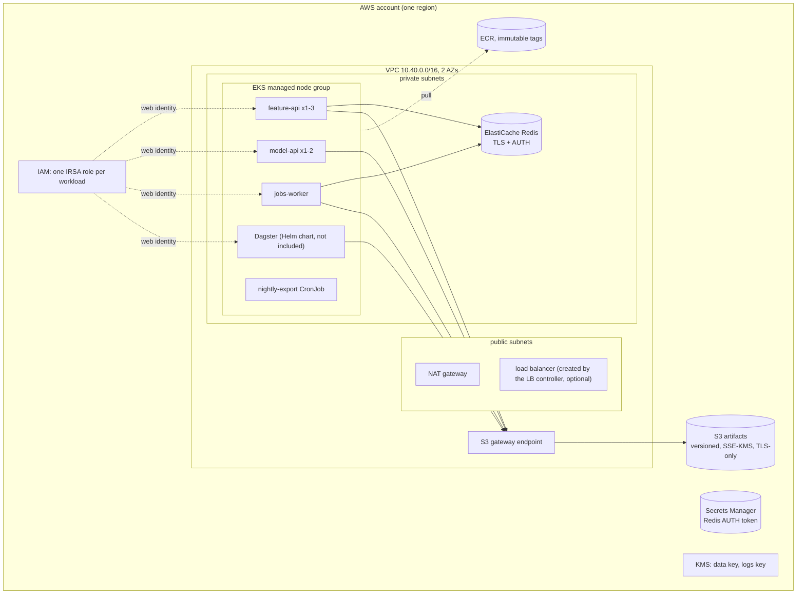

# Architecture

## Components

| piece | choice | why |
|---|---|---|
| compute | EKS, one managed node group (t3.large x 1-4) | the team needs batch (Dagster runs), always-on APIs and a CronJob on the same nodes; one cluster is cheaper to run than separate VM groups per role and gives rolling deploys, probes and HPA for free |
| storage | one S3 bucket, prefixes per stage | snapshots and models are files; versioning gives recovery for pointer mistakes; prefixes make per-workload IAM simple |
| feature store | immutable SQLite snapshot per nightly build | point-in-time SQL with an index, one file to ship, rollback by pointer; fits the data size (see Limitations in the README) |
| cache and queue | ElastiCache Redis | one managed service covers the response cache and the job queue; `volatile-lru` eviction only touches keys with a TTL (cache entries, finished job records); queued and running jobs are never evicted |
| orchestration | Dagster assets | lineage per asset, asset checks that block downstream steps, schedules and sensors in code, and in-process `materialize` for tests |
| identity | IRSA | each pod gets its own short-lived credentials; no access keys anywhere |

## Why AWS rather than GCP

Both would work. The deciding points for this scenario:

- **Where the data already is.** The team's vendor files land in S3; staying in one cloud avoids egress and a second identity system.
- **Per-pod identity.** EKS IRSA and GKE Workload Identity are equivalent in effect. EKS needs an OIDC provider and trust policies (in `modules/iam`); GKE binds a Kubernetes SA to a Google SA. Neither needs static keys.
- **Managed Redis with TLS and AUTH.** ElastiCache and Memorystore both offer it. ElastiCache's AUTH token is set at create time and rotated with a two-step change (see the runbook).
- **Cost shape.** GKE Autopilot bills per pod and can be cheaper for a small, spiky workload; EKS has a fixed control-plane fee plus nodes. For an always-on pair of APIs plus nightly batch, the difference is small; the NAT gateway is the bigger dev line item on AWS (see cost notes).

## Data flow and the two pointers

1. `nightly_features_job` (02:00 UTC Tue-Sat): `raw_prices`, `raw_fundamentals` → `feature_snapshot` writes `features/v{N}.sqlite` (N = highest file ever written + 1; the write refuses to replace an existing key) and records it as `features/STAGED` with its SHA-256. The blocking point-in-time check runs on the staged file. Only if it passes does the check record N and its hash in `features/CHECKED`, and `publish_feature_snapshot` moves `features/CURRENT` to N only when STAGED and CHECKED agree (keeping the previous version, key and hash for rollback). Blocking checks on the raw tables stop the run even earlier.
2. Feature API pods poll `features/CURRENT` (every `MLPI_REFRESH_SECONDS`), download v N to an `emptyDir`, check its SHA-256 against the pointer, open it read-only and swap. Requests in flight finish on the old reader; old local files are deleted once no request holds them (the two most recent are kept for instant rollback).
3. `weekly_retrain_job` (Sunday 04:00 UTC): `training_set` → `candidate_model` → `model_evaluation` → `model_artifact`. The last one only materializes if the gate passes.
4. `promote_on_approval` sensor (off by default) sees the `model_artifact` materialization and runs `promote_model_job`, which moves `models/CURRENT`. With the sensor off, a human runs that job after reading the evaluation.
5. Model API pods poll `models/CURRENT` and load the JSON model. They fetch features from the feature API over HTTP.

## Failure behaviour

| failure | effect |
|---|---|
| raw data fails a check | downstream assets not materialized; `features/CURRENT` unchanged; APIs keep serving the previous snapshot |
| the new snapshot fails the point-in-time check | the file stays as `features/STAGED` for inspection; `publish_feature_snapshot` does not run; `features/CURRENT` unchanged (tested) |
| a downloaded snapshot does not match the pointer's hash | refused; the pod keeps the loaded version and counts a refresh error |
| gate fails | no `model_artifact`; sensor does nothing; `models/CURRENT` unchanged |
| pointer names a missing or mismatched file | loader logs, counts a refresh error (`/stats`), keeps the loaded version |
| Redis down | feature API serves from the snapshot (fail-open), counts cache errors; `POST /jobs` fails until Redis is back |
| worker dies mid-job | heartbeats stop, the lease expires, another worker (or the restarted one) runs it again; at most 3 attempts. A slow but live worker keeps renewing its lease and is not interrupted |
| handler hangs | after `MLPI_JOB_MAX_RUNTIME_SECONDS` (default 1 hour) the heartbeat thread stops renewing the lease and stops touching the alive file; another worker reclaims the job when the lease runs out, and the liveness probe (`mlplatform worker-alive`, 5 minutes) restarts the stuck pod. Within the max runtime a long job keeps both fresh |
| Redis blip during a heartbeat | logged and retried on the next tick until the lease would have run out; the queue uses its own Redis client with 5 s timeouts (the cache client's 0.2 s is for fast failure on reads) |
| the publish step is run on its own, or two nightly runs interleave | `publish_feature_snapshot` refuses unless `features/CHECKED` (written by the passing check) names the same version and hash as `features/STAGED`; nightly runs are also queued one at a time (`deploy/dagster/dagster.yaml`) |
| feature API down | model API returns 503 for `/predict`; its readiness only reflects its own model |
